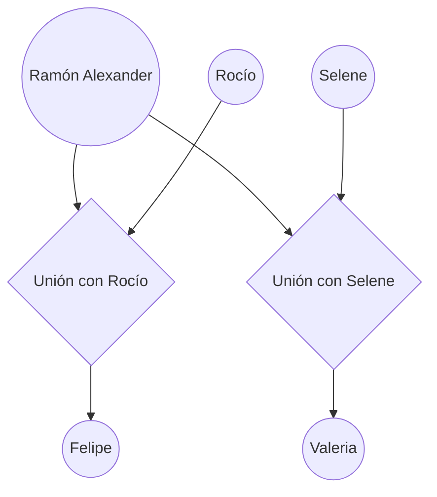

# Cómo se guarda el grafo familiar

La persistencia actual usa SQLite, una base SQL relacional. Encima hay un modelo de grafo con identidades y conexiones explícitas. El backend recorre las conexiones; React Flow y ELK las presentan visualmente. Las coordenadas del dibujo no definen el parentesco.

## Tablas actuales

| Tabla | Contenido y relación |
|---|---|
| `people` | UUID estable, nombre, resumen, estado de vida, revisión y versión. |
| `personFields` | Muchos campos por persona: UUID propio, `personId`, nombre, sección, tipo, valor JSON validado, procedencia, fecha de observación y marca sensible. |
| `graphNodes` | Registro común de personas, uniones, lugares, acontecimientos y grupos. Una persona reutiliza exactamente su UUID de `people`; los demás nodos tienen UUID propios. |
| `relationships` | Aristas entre personas: origen, destino, tipo (`parent`, `partner`, `godparent`, `close`), contexto, revisión y versión. |
| `graphConnections` | Aristas con nodos compartidos: participación en unión, descendencia asociada, origen, residencia, descanso, participación, pertenencia y ubicación. |
| `sources` | Identidad del documento, nombre, hash, ruta local relativa, formato y tamaño. Los bytes quedan en `data/originals/`. |
| `assertions` | Afirmaciones o transcripciones sobre una persona con fuente y estado de revisión; pueden coexistir versiones contradictorias. |
| `relationshipEvidence` | Varias citas por relación, con referencia formal a `sources` y registro de origen cuando existe. |
| `graphCitations` | Citas textuales por conexión compartida. Actualmente la procedencia documental aquí se conserva en el texto; aún no hay una clave foránea a `sources` en esta tabla. |
| `imports`, `importRecords` | Lotes CSV y correspondencia entre cada registro original y su persona. |
| `requests`, `audit` | Repetición segura de operaciones e historial de cambios. |

Las propiedades personales son extensibles: un campo nuevo agrega una fila a `personFields`, sin crear columnas ni modificar la tabla `people`. Los tipos de vínculo sí pertenecen a un catálogo explícito y validado; ampliarlo requiere una modificación del esquema y del código.

## Ejemplo de dos uniones

Ramón conserva una sola ficha y participa en dos uniones. Cada unión puede tener sus propias fechas, estado y evidencia. Una pareja dibujada no acredita por sí sola un matrimonio o un divorcio. Internamente la conexión `union_child` apunta de la persona hacia la unión; la interfaz la dibuja en sentido descendente para facilitar la lectura.

Además se registran, de manera explícita, los vínculos de progenitor a hijo en `relationships`. Asociar un hijo a una unión no crea automáticamente filiación con todos sus participantes. Hermanos o abuelos pueden encontrarse siguiendo varios enlaces; no es necesario repetir esas relaciones derivadas como hechos independientes.

## Cómo se incorporan las imágenes

La lectura del recorte es asistida y revisada; todavía no existe un importador automático de imágenes en la interfaz. Se conserva la imagen original por hash, se cotejan las etiquetas con los UUID existentes y se registra únicamente la topología visible. Un extremo recortado o un nombre ambiguo queda sin enlazar. La siguiente captura debe solaparse un poco con la anterior para reconocer las mismas personas y uniones.

Cada propuesta conserva su evidencia y queda pendiente. La misma operación puede repetirse sin crear nuevos IDs ni duplicar las conexiones; una imagen diferente requiere cotejar los IDs ya registrados. No se deduce que dos personas con el mismo nombre sean la misma identidad ni que dos uniones con los mismos participantes sean el mismo acontecimiento.

En el primer recorte se reutilizaron 22 personas existentes y se agregaron 8 uniones, 24 filiaciones propuestas y 28 conexiones entre personas y uniones. La línea roja hacia Alberto se mantuvo pendiente, conforme a la aclaración del usuario. Se incorporó una referencia a la imagen en Fuentes de cada una de las 22 fichas. El archivo conserva 289 personas: no hubo altas ni fusiones de identidad.

La comprobación se hizo primero en una copia de SQLite y luego sobre el resultado real: todas las filas anteriores permanecen idénticas, repetir la operación no crea cambios, y los controles de integridad y claves foráneas pasan. El manifiesto, resultado y script de esta lectura están en `data/audit/crop-01-*` y `data/audit/ingest-crop-01.ts`; son archivos familiares privados excluidos del control de versiones. La copia previa real está indicada en `data/audit/crop-01-result.json`.

## Qué significa usar SQL para un grafo

Los nodos y aristas son el modelo de información; SQL es el mecanismo de almacenamiento actual. Las claves foráneas mantienen extremos válidos, los índices facilitan localizar conexiones, las transacciones hacen atómica una importación y una consulta recursiva impide ciclos de ascendencia. El recorrido del vecindario combina ambos tipos de aristas en el backend.

No usamos una base nativa de grafos ni un motor de vectores. Un UUID identifica; una arista expresa un vínculo; un vector semántico serviría para comparar textos o fotografías, pero no sustituiría los parentescos y todavía no está implementado. Para crecer se puede optimizar la consulta o migrar la persistencia conservando los UUID; esa migración requerirá trabajo explícito.
